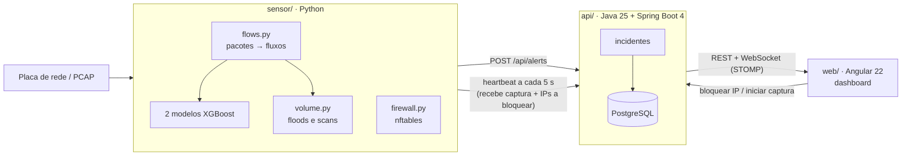

# IDS — Detecção de Intrusões com Machine Learning

Sistema de detecção e resposta a intrusões de rede, de ponta a ponta: um **sensor** em Python captura o tráfego
real da placa de rede, classifica cada fluxo com modelos treinados no
[CIC-IDS-2017](https://www.unb.ca/cic/datasets/ids-2017.html) e detecta floods por volume; uma **API** em Java agrupa
os alertas em incidentes; um **dashboard** em Angular mostra tudo ao vivo e permite **bloquear a origem do ataque**
no firewall com um clique.

<!-- TODO: GIF da demo (ataque -> incidente ao vivo -> bloqueio -> ataque para) -->
<!-- TODO: prints da visão geral e do detalhe de um incidente -->

## O que ele faz

- **Captura real:** lê os pacotes com `tcpdump` (ou um arquivo PCAP) e monta os fluxos com as mesmas ~80 features
  do CIC-IDS-2017.
- **Detecção em duas etapas com ML:** um XGBoost decide se o fluxo é ataque; um segundo diz o tipo (DDoS, PortScan,
  WebAttack, SQL Injection ou Desconhecido).
- **Detecção por volume:** cobre o que um modelo que olha um fluxo por vez não enxerga (SYN flood, UDP flood, DDoS
  e port scans rápidos).
- **Incidentes ao vivo:** vários alertas do mesmo ataque viram um incidente só, que aparece no dashboard na hora
  (WebSocket) como ativo e depois encerrado.
- **Resposta (IPS):** o botão "Bloquear origem" cria a regra no `nftables` da máquina do sensor; o desbloqueio
  também é pelo dashboard. Nunca bloqueia a própria máquina, o gateway nem a API.
- **Controle remoto do sensor:** iniciar e parar a captura pelo dashboard, sem abrir nenhuma porta no sensor.

## Arquitetura



O sensor nunca recebe chamadas: ele manda o próprio estado para a API a cada 5 s e recebe na resposta o que o
dashboard pediu. Por isso funciona em outra máquina, atrás de NAT, sem expor nada.

## Resultados

Conjunto de teste com **90.705 fluxos** que nenhum dos modelos viu no treino (os dois modelos juntos, como rodam ao
vivo; notebook `05_pipeline_completo`):

| Classe | Precisão | Recall | F1 | Fluxos no teste |
|---|---:|---:|---:|---:|
| BENIGN | 99,97% | 99,95% | 99,96% | 64.321 |
| DDoS | 99,90% | 99,93% | 99,91% | 25.598 |
| PortScan | 96,43% | 98,44% | 97,42% | 384 |
| WebAttack | 98,99% | 98,75% | 98,87% | 399 |
| SQL Injection | 100% | 33,33% | 50,00% | 3 |

- **Alarmes falsos:** 30 de 64.321 fluxos normais (0,05%). **Ataques perdidos:** 17 de 26.384.
- **Velocidade:** ~750 mil fluxos/s na classificação (só o modelo, sem a captura).
- **SQL Injection** tem só 3 exemplos no teste (e poucas dezenas no dataset inteiro); o número não é confiável
  para nenhum lado.

Os números vêm de `sensor/results/modelos/*.json` e do notebook 05, e são gerados de novo a cada retreino.

## Decisões técnicas

Algumas coisas que não aparecem na maioria dos projetos com esse dataset:

- **O extrator de fluxos reproduz o CICFlowMeter com os bugs dele.** O modelo foi treinado com features geradas
  pela ferramenta em Java que criou o dataset. Para o modelo funcionar no tráfego real, o `sensor/src/flows.py`
  calcula tudo do mesmo jeito, inclusive os erros (o padding do Ethernet conta como dados, o primeiro pacote entra
  duas vezes em algumas médias...), conferido feature a feature contra os CSVs. O pacote `cicflowmeter` do PyPI
  não serve: calcula várias features em outra escala.
- **As flags TCP do CIC-IDS-2017 estão erradas.** Os fluxos de port scan só têm `PSH`, nunca o `RST` das portas
  fechadas. Um extrator correto não reproduz isso, então essas colunas ficaram fora dos modelos.
- **Atalhos removidos.** `Destination Port` e `Init_Win_bytes_*` identificam o ambiente do laboratório onde o
  dataset foi gravado, não o ataque. Com eles o modelo tira nota alta no teste e erra na rede de verdade.
- **Duplicatas removidas antes de separar treino e teste**, para o mesmo fluxo não estar nos dois lados.
- **Volume cobre o ponto cego do ML.** Um SYN flood é feito de milhares de conexões que, uma a uma, parecem normais
  (o modelo chama cada uma de PortScan) e o dataset não tem nenhum ataque UDP. O `volume.py` conta pacotes em
  janelas de 10 s; quando um ataque de volume está ativo, ele dá o nome aos fluxos, para o mesmo ataque não ter dois
  tipos.
- **Bloqueio seguro.** O firewall usa uma tabela própria no `nftables` (não mexe no ufw/firewalld/Docker), a lista
  de IPs protegidos é conferida na API e de novo no sensor, e tudo é desfeito ao desligar o serviço.

## Limitações

- Treinado só com três dias do CIC-IDS-2017 (laboratório, 2017): DDoS, PortScan e ataques web. Outros ataques
  caem em "Desconhecido" ou passam como normais.
- As métricas acima são do conjunto de teste do dataset; a taxa de alarmes falsos numa rede real ainda não foi
  medida.
- A API não tem login: quem alcança a porta 8080 consegue iniciar capturas e bloquear IPs. Feito para rodar numa
  rede de confiança.
- A captura ao vivo e o bloqueio só funcionam em Linux (`tcpdump` e `nftables`, com `sudo`).
- O estado dos sensores fica em memória na API (é refeito sozinho pelo heartbeat se a API reiniciar).

## Como rodar

Precisa de Linux, Python 3 (testado no 3.14), JDK 25, Node 24 e Docker (para o PostgreSQL).

```bash
git clone git@github.com:Guilhermedantass/IDS-Network-Intrusion-Detection.git
cd IDS-Network-Intrusion-Detection
python -m venv .venv && .venv/bin/pip install -r sensor/requirements.txt
```

Em três terminais:

```bash
cd api && ./mvnw spring-boot:run             # API em localhost:8080 (sobe o PostgreSQL sozinha)
cd web && npm install && npm start           # dashboard em http://localhost:4200
./ids servico --api http://localhost:8080    # sensor (pede o sudo uma vez); controle pela página Sensores
```

Para ver um incidente sem esperar um ataque de verdade: `./ids teste-flood --api http://localhost:8080` (flood
limitado contra o próprio PC) ou `./ids teste-nmap --api http://localhost:8080`.

Os modelos treinados já estão no repositório; os CSVs do dataset só são necessários para retreinar.

### Testes

```bash
cd sensor && ../.venv/bin/python -m pytest   # sensor
cd api && ./mvnw test                         # API (PostgreSQL descartável com Testcontainers)
cd web && npm test                            # dashboard (Vitest)
```

## Estrutura

| Pasta | O que tem | Detalhes |
|---|---|---|
| `sensor/` | Python: captura, extrator de fluxos, modelos, detecção por volume, firewall, notebooks de treino | [sensor/README.md](sensor/README.md) |
| `api/` | Java 25 + Spring Boot 4.1, PostgreSQL + Flyway, incidentes, WebSocket, controle dos sensores | [api/README.md](api/README.md) |
| `web/` | Angular 22 (standalone, signals, sem zone.js): visão geral, incidentes, sensores | [web/README.md](web/README.md) |

## Tecnologias

**Sensor:** Python, XGBoost (com SHAP para escolher as features), scikit-learn, pandas, dpkt, tcpdump, nftables, SQLite, pytest ·
**API:** Java 25, Spring Boot 4.1, Spring Data JPA, PostgreSQL 18, Flyway, WebSocket/STOMP, Testcontainers ·
**Dashboard:** Angular 22, signals, STOMP.js, Vitest

## Próximos passos

- Técnica do MITRE ATT&CK em cada incidente.
- Explicação de cada incidente por uma LLM local (Spring AI + Ollama).
- `docker compose up` com banco, API e dashboard.
- CI no GitHub Actions.

## Autor

Guilherme Martins
